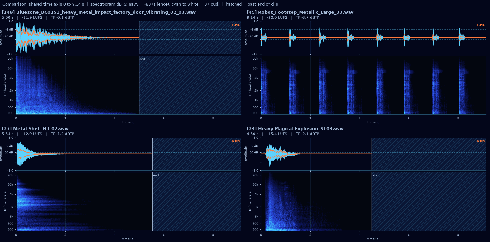
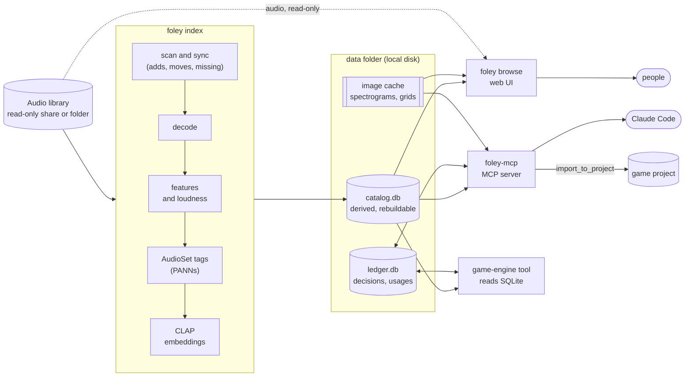

# Foley

**Foley indexes a sound library so that Claude Code, which cannot hear, can search it, inspect it and pick audio from it.**


Point Foley at a folder or network share of sound effects and music. It analyzes every file once, offline, keeps that analysis in sync as the library changes, and stores it in two SQLite files. Claude Code reaches the catalog through an MCP server: it searches by description, looks at spectrograms to compare candidates, and imports the winner into your game project at the right loudness. People get a fast local browser for auditioning the same library, and anything else (an in-editor sound board, a script) can read the SQLite files directly.

> Foley is an internal Soverance Studios tool shared as-is. It is not a supported product: there is no support commitment and no release cadence.

## What it does

- **Semantic:** words from file names, folders, embedded metadata (BWF, iXML, ID3) and UCS category names; AudioSet tags (PANNs CNN14); CLAP audio embeddings. Search is **hybrid**: keyword matching blended with CLAP similarity between the query and the audio itself, so a file can be found by how it sounds even when its name says nothing. Find-similar works from any file.
- **Technical:** loudness (ITU-R BS.1770 integrated, short-term, true peak), duration, attack and decay, onsets, spectral centroid and rolloff, band energy, tempo, loop seams, and exact and audio-identical duplicates.
- **Visual:** a waveform and log-mel spectrogram image per file at fixed scales, plus comparison grids, which Claude reads with its vision.

The library is treated as read-only: indexing, search, the browser and every MCP tool only read it.

## Quick start

You need [uv](https://docs.astral.sh/uv/) (it installs Python 3.12 for you) and, for formats libsndfile cannot read, [ffmpeg](https://ffmpeg.org/) on `PATH`. Windows, Linux and macOS (Apple silicon) work; an NVIDIA GPU is optional.

```powershell
# Windows (elsewhere use your package manager, e.g. brew install uv ffmpeg)
winget install --id astral-sh.uv
winget install --id Gyan.FFmpeg
```

Get the code and install it:

```
git clone https://github.com/soverance/foley
cd foley
uv sync                    # core: catalog, features, loudness, keyword search, images, MCP server
uv sync --extra models     # adds PyTorch + transformers for AudioSet tags, CLAP and hybrid search
```

The `models` extra is optional, but it is what makes search understand sound. On Windows and Linux it installs PyTorch's CUDA 12.6 build, which uses an NVIDIA GPU (driver 560 or newer, GTX 900 series and up) when there is one and the CPU otherwise, more slowly. Model weights download on first use: PANNs (about 330 MB) into the data folder, CLAP checkpoints (0.6 to 0.8 GB each) into the Hugging Face cache.

Configure it: copy the example and set `[library] root`.

```
cp foley.toml.example foley.toml        # or put it in %LOCALAPPDATA%\Foley\ (~/.local/share/foley)
```

```toml
[library]
root = "//nas.example.local/Audio"      # a share, a mapped drive or a local folder
```

Index, search and browse:

```
uv run foley index                      # first run analyzes everything; later runs only what changed
uv run foley status                     # counts, staleness, model progress
uv run foley search "heavy metal impact with a long ringing tail"
uv run foley browse                     # http://127.0.0.1:8765/
```

A file is searchable as soon as its metadata, features and loudness are in; tags and embeddings fill in afterwards. Indexing is resumable: stop it any time and run it again.

To have `foley` and `foley-mcp` on your `PATH` everywhere, install Foley as a uv tool instead of using `uv run`:

```
uv tool install --editable ".[models]"
```

Then register the MCP server with Claude Code, in your game repo's `.mcp.json`:

```json
{
  "mcpServers": {
    "foley": { "command": "foley-mcp" }
  }
}
```

If `foley.toml` is not in the current directory or the default data folder, add `"env": {"FOLEY_CONFIG": "C:/path/to/foley.toml"}`. [docs/mcp-tools.md](docs/mcp-tools.md) has the details.

## How Claude Code uses it

The MCP server exposes seven tools. A typical pick goes like this:

1. **`search_audio`** with a short description and technical filters, for example `"short bright UI confirm beep"` with `max_duration_s = 1.0`. Results are compact: id, path, match score, a one-line caption, top tags, duration, loudness and attack.
2. **`render_comparison`** on the top 4 to 6, then **Read** the returned PNG. Claude compares waveforms and spectrograms drawn at identical scales.
3. **`find_similar`** on the best near-miss, to see alternatives that sound alike.
4. **`import_to_project`** with the winner: the file is copied into the game project, normalized to the slot's loudness target, and the usage is recorded.

Also available: `describe` (the full record for one file), `catalog_status`, and `get_shortlist`, which returns the sounds a person starred while listening in `foley browse`.

This is what Claude sees after step 2 for "heavy metal impact with a long ringing tail":



Without hearing a thing, it can tell that candidate 45 is a run of separate footsteps rather than one impact, and that 27 has the long tonal partials of ringing metal.

A block like this in the game repo's `CLAUDE.md` sets the workflow:

````markdown
## Audio

Sound effects and music come from the studio library through the `foley` MCP server.
Never pick audio by file name alone.

- Before searching, call `get_shortlist`: the user may already have starred a sound for this.
- `search_audio` with a short description of the sound plus filters (duration, loudness,
  attack). Pass `project = "my-game"` to hide sounds already rejected for this game.
- `render_comparison` on the top 4-6 and Read the image. Choose by duration, attack,
  tail, brightness and noisiness. Use `find_similar` on a near miss.
- `import_to_project` into `res://audio/...` with a `usage_key` such as `sfx.ui.confirm`,
  so loudness follows `foley.project.toml`. Never overwrite an existing file unasked.
- Hero sounds (title music, boss and signature weapon sounds) go to the user for review:
  list the 2-3 best candidates with their ids instead of importing.
````

Loudness targets per usage slot live in a `foley.project.toml` in the game repo; see [docs/configuration.md](docs/configuration.md#per-project-settings-foleyprojecttoml).

## foley browse

`foley browse` is a local web UI for people. Browse the library's folders, search it, and audition files with loudness matching while you see Foley's analysis: overview image, loudness gauge, caption, tags, similar sounds, metadata, licence and duplicates. It works offline and never writes to the library.

| Hybrid search with match meters | Find similar |
| --- | --- |
|  |  |
| **Test-set mode** for labelling search answers | **Scans:** a daily `foley index` while it runs |
|  |  |

Star sounds to put them on a shortlist, with a note, and Claude Code picks them up with `get_shortlist`. Left running, the browser keeps the catalog current with a daily scan. It can also serve a studio LAN (mind your sample licences, and note that it has no authentication). See [docs/browse.md](docs/browse.md) for the tour and keyboard shortcuts, and [docs/deploy-windows.md](docs/deploy-windows.md) to run it always-on.

## Architecture



`catalog.db` holds everything derived from the library and can be deleted and rebuilt. `ledger.db` holds what cannot be regenerated (decisions, project usages, the duplicate-cleanup log), keyed by file content so it survives moves. Both are public contracts, documented in [docs/schema.md](docs/schema.md), so an engine-side tool can read them without any Python. The design and its reasoning are in [docs/design.md](docs/design.md).

## Status and roadmap

**Phase 1 is done:** catalog and incremental sync, DSP features and loudness, captions, images, keyword and hybrid search, find-similar, `foley eval`, the MCP server with `import_to_project`, and `foley browse` with daily scans.

Next:

- **The review loop:** an engine-side review queue that records decisions, plus MCP tools to read past decisions as examples (`get_examples`), record them (`record_decision`) and check whether an effect masks the music under it (`check_mix_fit`).
- **Duplicate cleanup actions:** `foley dedupe report` exists today; `plan`, `apply` (move to quarantine), `restore` and `purge` are designed but not built.
- **Preference learning:** once enough decisions exist, a per-category model over embeddings and features that predicts what you would approve.

## Documentation

- [docs/configuration.md](docs/configuration.md): every `foley.toml` setting, and `foley.project.toml`
- [docs/mcp-tools.md](docs/mcp-tools.md): the MCP tools, their inputs and results
- [docs/browse.md](docs/browse.md): the browser, shortcuts, test-set mode, scans, LAN serving, branding
- [docs/eval.md](docs/eval.md): writing a search test set and reading `foley eval`
- [docs/deploy-windows.md](docs/deploy-windows.md): always-on browser with a logon task and firewall rule
- [docs/design.md](docs/design.md): how Foley works and why
- [docs/schema.md](docs/schema.md): the SQLite contract

## Safety

Foley never modifies the library. Indexing, search, the browser and all MCP tools open library files read-only, and a test enforces it. `import_to_project` writes only into the game project you name. The only commands ever allowed to change the library are the planned `foley dedupe apply`, `restore` and `purge`, run by a person from the command line: they move duplicates to a quarantine folder instead of deleting them, verify every file byte for byte first, and log every action.

## License

MIT; see [LICENSE](LICENSE). Third-party components and model weights are listed in [THIRD_PARTY_NOTICES.md](THIRD_PARTY_NOTICES.md).
