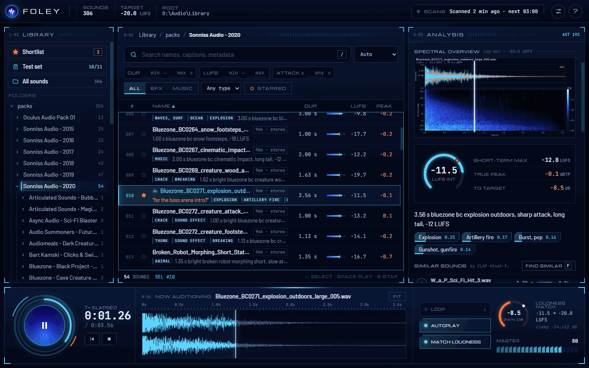
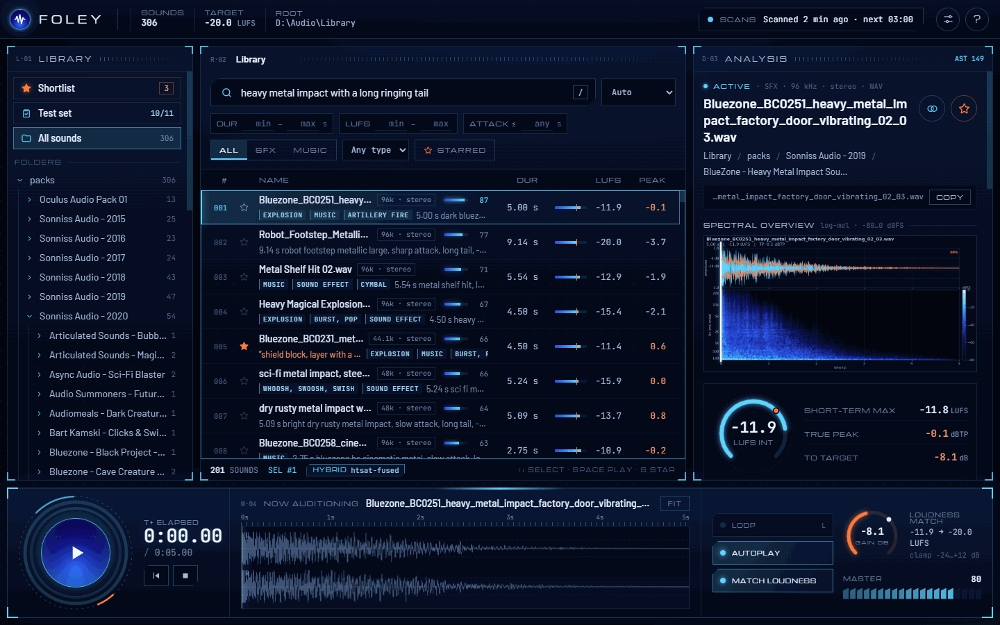
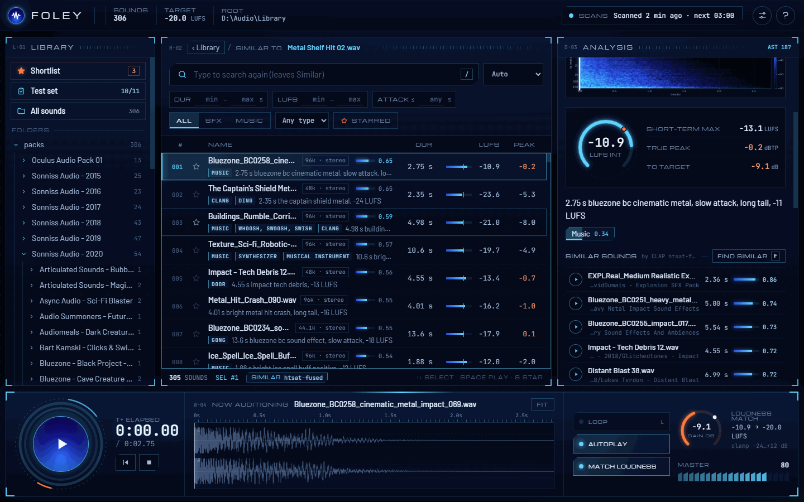
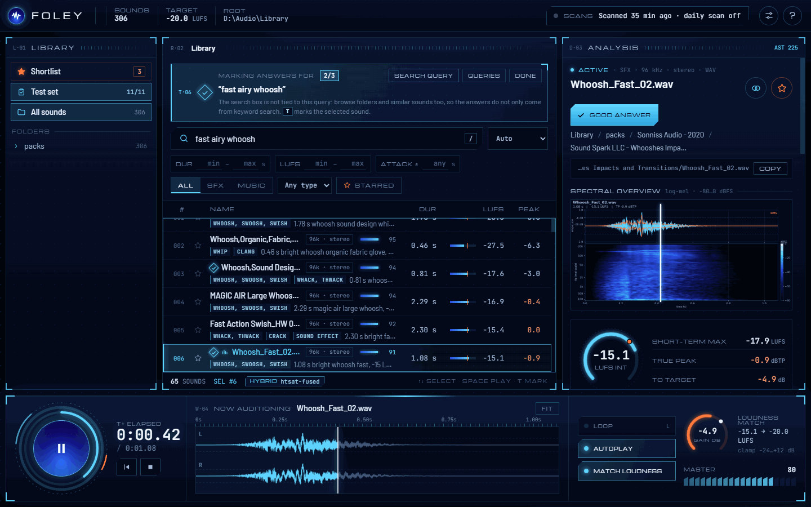
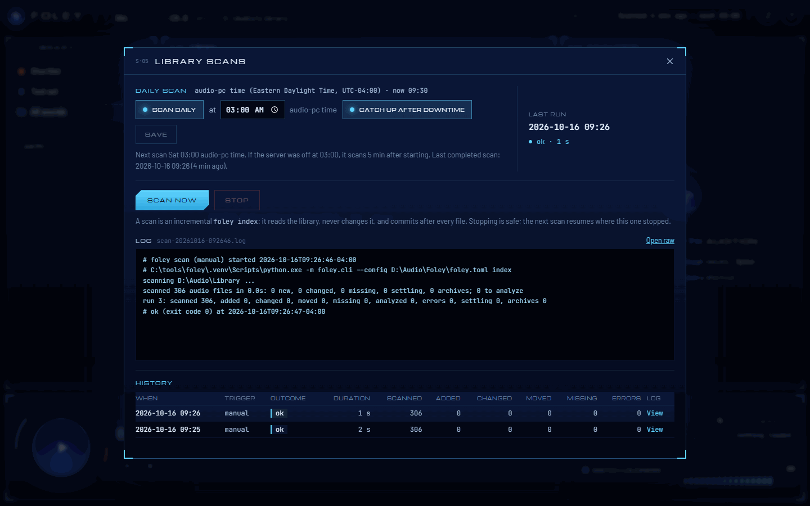

# foley browse

`foley browse` is a local web UI for people: browse the library's folders, search it, audition files with loudness matching, and see everything Foley knows about a sound while you listen. Stars and notes you leave there reach Claude Code through the `get_shortlist` MCP tool.

```
foley browse                    # http://127.0.0.1:8765/, opens your browser
foley browse --port 9000 --no-open
foley browse --verbose          # log every request
foley browse --log-file C:/Users/me/AppData/Local/Foley/logs/browse.log
```

It works offline: no CDN, no build step, fonts bundled (Michroma, Barlow and JetBrains Mono, under the SIL Open Font License). It never writes to the library. Everything it caches (peaks, images, the shortlist, the scan schedule and logs) lives in the data folder; the only other file it writes is the test set you configured.



## The window

- **Top bar:** the number of active sounds, the loudness-match target, the library root, and the **Scans** indicator (last scan, next scheduled one). The gear button holds display settings and `?` lists the shortcuts.
- **Library (left):** the **Shortlist** (your stars), the **Test set** (when `[eval] testset` is set), **All sounds** and the folder tree with recursive counts.
- **Results (middle):** search box, sort, and filters for duration, loudness, maximum attack, SFX/music, file type and starred. Each row shows the name, format, the top AudioSet tags, the caption, duration, a loudness bar with LUFS, and true peak. In a search, a meter and number show how well each file matches.
- **Analysis (right):** status and format, the folder path with **Copy**, the spectral overview image (with a playhead), a loudness gauge (integrated LUFS, short-term max, true peak, gain to the target), caption, tags with scores, **Similar sounds**, your shortlist note, readouts and band energy, and collapsible sections for licence, exact duplicates, ledger history, embedded metadata and the raw catalog record.
- **Transport (bottom):** play/pause, restart and stop, a zoomable waveform you can click or drag to seek, **Loop**, **Autoplay** (play each sound as you select it), **Match loudness** with its gain readout, and master volume.

**Match loudness** plays every clip at `[browse] loudness_target_lufs` (default -20 LUFS) so quiet and hot files audition at the same level, with the gain clamped to -24..+12 dB. It changes playback only. Files the browser cannot play natively (AIFF) are transcoded to WAV on the fly.

The gear button switches the console decoration (corner brackets, rulers, dot grid) on or off and picks comfortable or compact rows; both are remembered per browser. Panes can be resized by dragging their edges.

## Search

Type in the search box (or press `/`). With CLAP embeddings in the catalog, search is hybrid: keyword matching over names, folders, metadata, tags and captions is blended with CLAP similarity between your words and the audio. The footer says `HYBRID` and the checkpoint in use, and each result shows a match meter. The first search after the server starts loads the CLAP text encoder on the CPU, which takes a few seconds. Search is scoped to the folder you are in; click **All sounds** to search everything.



Without embeddings (models not installed, or not computed yet) search is keyword-only, and a note says why.

## Similar sounds

The Analysis pane lists the sounds closest to the selected one by CLAP audio embedding. **Find similar** (`F`) fills the results with all of them, ranked by similarity, with the usual filters and sorting; the breadcrumb says what they are similar to, and **‹ Library** goes back.



## Shortlist and notes

Star a sound (`S`, or the star button) to put it on the shortlist, and type a note such as "for the boss arena intro?" in the Analysis pane. Stars are stored in `shortlist.json` in the data folder, keyed by file content, so they survive moves and renames. Claude Code reads them with the MCP tool `get_shortlist`, which is the simplest way to hand your picks to it.

## Keyboard shortcuts

| Key | Action |
| --- | --- |
| `Space` | Play / pause |
| `Enter` | Play from the start |
| `Esc` | Stop (or leave a text field) |
| `←` `→` | Seek ±1 s (`Shift`: ±5 s) |
| `L` | Loop on / off |
| `↑` `↓` | Previous / next sound |
| `PgUp` `PgDn` | Jump a page |
| `Home` `End` | First / last sound |
| `S` | Star / unstar |
| `F` | Find similar sounds |
| `T` | Mark / unmark a good answer for the active test query |
| `/` | Focus search (`↓` goes back to the results) |
| `?` | Show the shortcuts |

Click or drag the waveform or the overview image to seek. Double-click a row to play it from the start. Shortcuts are ignored while you type in a field.

## Test-set mode

With `[eval] testset` set in `foley.toml`, **Test set** in the left pane opens the list of test queries and how many answers each has. You can add and delete queries there too. Pick one, and a banner shows the query while you browse, search and listen as usual. Press `T` on each file you would accept (1 to 3 per query). The browser writes the answers to the TOML file straight away, keeping its header comments; hand edits made in between are kept too.



The search box is deliberately not tied to the query. Find answers by browsing folders and similar sounds as well as searching, so the test set does not favour keyword search. **Search query** puts the query's text and filters into the search box when you want it. `foley eval` then scores search against these answers; see [eval.md](eval.md).

## Scans

Left running, the browser keeps the catalog current. Click the scan status in the top bar to open the Scans dialog:

- turn the **daily scan** on and pick a time (the server machine's local time);
- **catch up after downtime:** if the server was off at the scheduled time, scan a few minutes after it starts;
- **Scan now** and **Stop**, with the live log while a scan runs;
- the **history** of recent scans (trigger, outcome, duration, files scanned, added, changed, moved, missing, errors) with each log.



A scan is an incremental `foley index` in a subprocess: read-only on the library, committing after every file, so stopping is always safe and the next scan resumes. Only one scan runs at a time; if a `foley index` from the command line holds the index lock, the scheduled scan is recorded as skipped. Defaults come from `[schedule]` in `foley.toml`; once you save in the dialog, the schedule lives in `schedule.json` in the data folder (delete it to fall back). Logs are kept in `<data_dir>/logs/`.

## Serving it on your network

By default `foley browse` listens on 127.0.0.1 and answers only requests addressed to localhost. To use it from other machines:

```toml
[browse]
host = "0.0.0.0"
port = 8765
allowed_hosts = ["foley.example.lan"]
```

and point a DNS name (here `foley.example.lan`) at the machine. Requests are answered only when their `Host` header is localhost, a loopback IP, the bound address, one of `allowed_hosts`, or this machine's own name or IP; anything else gets 403, which blocks DNS rebinding. A POST from another origin is refused too. Starting on a non-loopback address without `allowed_hosts` logs a loud warning.

Before you do this, mind two things:

- **Licences.** Sample libraries are usually licensed to named users or seats. Streaming a library to everyone on a network can breach that. Serve it only to people licensed to use it.
- **No authentication.** Anyone who can reach the port can browse and download every audio file in the library, read the catalog, edit the shortlist and test set, and start or stop scans. It is meant for a trusted studio LAN behind a firewall, never the internet. Use a firewall rule limited to your subnet.

[deploy-windows.md](deploy-windows.md) sets this up to run always-on from a tray icon, with a logon task and a firewall rule.

## Branding

To show your own logo in the top bar, point `[browse] brand_dir` at a folder holding:

- `logo.png`: the round mark next to the product name, shown 30 px wide (about 128 px square is plenty);
- `wordmark.png`: an optional light-on-dark line under the name, shown 7 px tall.

Either may be missing; nothing else in the folder is served. Without `brand_dir` the UI shows a neutral waveform mark. Keep the folder outside the repo.

## The images

The overview image and the grids `render_comparison` makes for Claude use fixed scales and one colour key, so any two images compare directly:

- waveform cyan on a fixed -1..1 scale, dashed lines at -6 and -20 dBFS, RMS envelope in orange;
- log-mel spectrogram from 20 Hz to 24 kHz at a fixed -80..0 dBFS: near-black navy is silence, rising through blue and cyan to white at full scale.

Images are rendered on demand and cached in `<data_dir>/images`.
