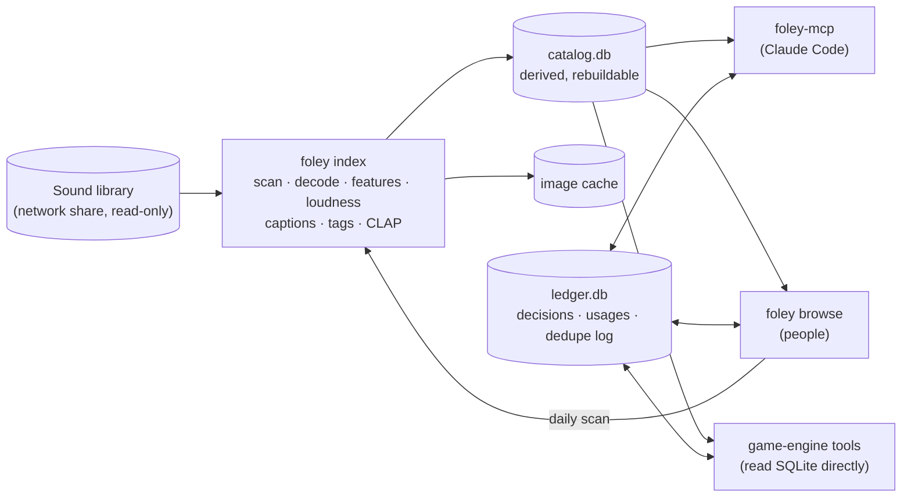

# Foley design

How Foley is put together and why. Read the section relevant to your change before changing behaviour. The SQLite contract is in [schema.md](schema.md), the MCP tools are in [mcp-tools.md](mcp-tools.md) and configuration is in [configuration.md](configuration.md).

## Purpose

Claude Code cannot hear. Left alone, it picks audio from file names, and a person has to review every pick by ear. That doesn't scale to a library of tens of thousands of sound effects and music files.

Foley analyses the whole library once, offline, keeps that analysis in sync as the library changes, and stores what each file sounds like as data Claude Code can query:

- **Semantic:** file and folder names, embedded metadata (BWF, iXML, ID3, RIFF INFO), parsed UCS names, AudioSet tags, CLAP audio embeddings, and a one-line caption.
- **Technical:** loudness (ITU-R BS.1770), timing, envelope and spectral features.
- **Visual:** a waveform and spectrogram image per file at fixed scales, which Claude reads with its vision.

The goals:

- Claude Code finds good candidates from a text description in one tool call.
- Low-stakes sounds (UI, pickups, ambience variations) can be picked and loudness-normalized without manual review.
- A person reviews only hero sounds and low-confidence picks.
- The catalog stays in sync as files are added, moved or removed, without a full re-index.
- Duplicate files can be found, and later removed safely.
- One catalog serves several game projects.

People get the same catalog through `foley browse`, a web UI for browsing and auditioning the library.

Out of scope: generating or editing audio, mixing, replacing a person's ear on hero sounds, and shipping any of this inside a game build.

## Architecture

A Python indexer writes a local catalog. Three kinds of consumer read it: the MCP server for Claude Code, the browser for people, and any game-engine tool (for example an in-editor review board written in C#). **The SQLite files are the only interface between them.** No consumer calls another's code, so a C# tool needs nothing but an SQLite driver.

- **`catalog.db`** holds everything *derived* from the library: assets, features, tags, captions, embeddings, the search index and image records. It can be deleted and rebuilt from the library at any time.
- **`ledger.db`** holds what *cannot* be regenerated: people's decisions, which game uses which file, and the log of every change Foley makes to the library. Back it up; never rebuild it.
- Ledger rows key on **`content_hash`** (the file's bytes), not on asset ids or paths, so they survive moves, renames, duplicate cleanup and a full catalog rebuild. Consumers join the two files with SQLite `ATTACH`. If a file's bytes change, its old decisions no longer attach. That is intended: it is a different sound now.
- Both files run in WAL mode, so the indexer, the MCP server, the browser and an engine tool can all have them open at once.
- Both schemas are public contracts. Every change is a new numbered migration, documented in [schema.md](schema.md), and applied migrations are never edited.

## Storage and environment

- The library usually lives on a network share; the catalog lives on **local disk** (`%LOCALAPPDATA%\Foley` on Windows, `~/.local/share/foley` elsewhere). SQLite over SMB risks locking failures and corruption. Foley refuses a data folder inside the library.
- Every path is stored **relative to the library root**, with forward slashes, so a catalog works whether the share is reached by UNC path, mapped drive or mount point.
- Formats: WAV, FLAC, OGG, MP3 and AIFF, matched case-insensitively. Decoding uses soundfile, with ffmpeg as a fallback. Other files are ignored, except archives, which are reported as "not extracted".
- **Windows-native first, portable always:** pathlib everywhere and no Windows-only APIs on the core path. Windows-specific helpers (logon task, firewall rule) live under `scripts/windows/`.
- The models (PyTorch, transformers) are an optional extra. Without them, everything except tags, CLAP search and find-similar works.

## The library is read-only

Nothing in Foley writes to the library, with one planned exception: duplicate cleanup (see below), which goes through `nas_write.py`, runs only from the CLI and only when a person types it. Every other module opens library files read-only. `tests/test_readonly.py` enforces this with a runtime audit hook that fails on any write-intent open, rename, delete or subprocess aimed at the fixture library, from every entry point (index, MCP tools, browse endpoints, dedupe report).

## Library sync

`foley index` is incremental, resumable and idempotent. It is the only sync mechanism, and running it is always safe.

1. List the tree with `os.scandir`. On Windows, size and modification time arrive with the directory listing, so checking tens of thousands of files over SMB takes about a minute and opens nothing.
2. Compare each file's relative path, size and modification time with `catalog.db`.
3. Analyse only what changed, reading each file from the share once.
4. Commit after each file, so search keeps working during a long run and a crash loses at most one file.

| Change in the library | What Foley does |
| --- | --- |
| New file | Analyse it |
| Size or modification time changed | Re-analyse it, keeping the same asset id |
| Path gone | Mark it `missing` and keep the row, so decisions and usages stay valid |
| Moved or renamed | Re-point the existing asset to the new path, keeping its analysis and decisions. Matched cheaply by name, size and time when unambiguous, otherwise by content hash |
| Still being written (modified within `settle_minutes`, either side of now to absorb clock skew) | Skip it until a later run, listing it by name in the log; packs are often extracted in bulk. A modified time further in the future is the file's own date (zip entries store zone-less local time), so it is indexed, not held |
| Archive (`.zip`, `.rar`, `.7z`) | Don't index it; report it under "archives not extracted" |
| Decode failure | Mark it `error` with the reason, and retry on later runs |

Guards:

- **Mass-missing guard.** If a scan would mark more than 10% of the library (and at least 50 files) missing, the run fails instead. That usually means the share is half-mounted, not that the files were deleted. `--allow-mass-missing` overrides it.
- **Locking.** Only one indexer runs at a time, guarded by an OS-level lock that frees itself if the process dies.
- **History.** Each run is recorded in `index_runs`, which drives resuming and the staleness note that `catalog_status` and every search response carry.
- **Pruning.** `foley prune` removes catalog rows for assets that have been missing longer than a configured period and have no ledger entries. It touches only local files.

**When it runs.** On demand (`foley index`), and daily from `foley browse`. A machine that runs the browser permanently can also run the scan: its scheduler starts an ordinary `foley index` subprocess at a configured local time. If the machine was off at that time, it catches up shortly after starting. There is no live file watching: watching an SMB share drops events during bulk copies and doesn't survive disconnects, so a periodic scan would still be needed as the backstop.

## Analysis pipeline

Each file passes through these stages. Each stage has a version; changing a version re-runs that stage for every asset (`foley index --stage <name>` runs one stage, and `--force` re-runs it even if current).

| Stage | What it produces |
| --- | --- |
| `metadata` | pack and category from folders; BWF, iXML, ID3 and RIFF INFO fields; UCS names (`CATsub_Description_Creator`) parsed. Free semantic signal, done first and done carefully |
| `features` | DSP measurements (librosa, `n_fft` 2048, hop 512): duration, rate and channels; leading and tail silence (first and last −60 dBFS crossing); attack (10% of peak to peak); decay (peak to 40 dB below); onset count; spectral centroid, rolloff, flatness and ZCR; energy share in seven bands (sub <60 Hz, low, low-mid, mid, upper-mid, presence, air >6 kHz); tempo and loop-seam score for music and ambience |
| `loudness` | integrated LUFS, maximum short-term loudness and true peak (BS.1770 via pyloudnorm). Clips under 0.4 s have no valid integrated loudness: it is stored as null and their peak is used instead |
| `caption` | a one-line templated description from the name, tags and measurements: "0.42 s bright metallic impact, sharp attack, short tail, −14 LUFS" |
| `fts` | the FTS5 keyword index over name words, pack, category, metadata, tags and caption |
| `tags` | AudioSet labels from PANNs CNN14, every label scoring ≥ 0.1; sets `is_music` |
| `embeddings` | CLAP audio embeddings, one L2-normalized vector per file per checkpoint |

Notes:

- **One read per file.** All stages that need audio share one read and one decode. Worker processes read, hash, decode and measure; the main process alone writes SQLite, one transaction per file. Very long or high-rate files are decoded in blocks and resampled to fit a memory budget.
- **The model stages never gate search.** An asset is `active`, and so searchable, as soon as the core stages are current. Tags and embeddings fill in afterwards. A backfill over a large library takes hours and must not empty search while it runs. New tags refresh the asset's caption and search index.
- **Windows for the models.** Both models see at most 12 evenly spaced 10-second windows of mono audio (PANNs at 32 kHz, CLAP at 48 kHz). Window scores and embeddings are averaged; CLAP vectors are normalized again. GPU inference runs batched in the indexer process. Preprocessing was verified against each model's reference code (`eval/verify_models.py`).
- **Images are rendered on demand** and cached. Pre-rendering every file would cost gigabytes at full library size. Each image is 1024×512: the waveform with its RMS envelope on top, a log-mel spectrogram below (128 bands, 20 Hz to 24 kHz, fixed −80…0 dBFS range, one fixed colour map), and duration, loudness and peak in the header. **Fixed scales are mandatory** so that images compare side by side, both for people and for Claude.
- Every model-derived row records its model (name plus checkpoint revision), so a model upgrade re-runs only that stage.

## Search

- **Keyword:** FTS5 BM25, weighted towards the name and metadata, with prefix matching and a bonus for each distinct query term a file matches. Query text is reduced to words and quoted, so no user input can form FTS5 syntax.
- **Hybrid:** with embeddings present, the CLAP text embedding of the query is compared with every file's audio embedding by brute-force cosine (numpy over an in-memory matrix; about a millisecond for 40,000 × 512). The keyword and vector scores are each normalized to 0..1 and blended. The candidates are the union of the keyword hits and the vector top-N, so a file with an unhelpful name can still surface.
- **No vector database.** Even 40,000 512-dimensional vectors are about 80 MB, and brute force takes milliseconds in numpy or C#. This keeps native SQLite extensions out of every consumer. Revisit only past roughly 500,000 files.
- **Duplicates.** Exact duplicates (the same `content_hash`) collapse to one result.
- **CLAP has to earn its place.** CLAP is known to be weaker on synthetic and stylised game sounds than on field recordings. `foley eval` measures search on a hand-written test set and always reports keyword-only next to each checkpoint and blend weight. `--adopt` records the winner, and records weight 0 (keyword-only) when no hybrid configuration beats keyword-only. See [eval.md](eval.md).
- **Find similar** ranks files by audio-to-audio cosine.

## Claude Code integration

The MCP server keeps results compact (ids, paths, a caption, the top tags and a few key numbers, never raw feature arrays), so a search costs few tokens. **No MCP tool modifies the library.** `import_to_project` writes only into a game project.

The intended selection workflow, which a game repo can put in its own CLAUDE.md:

1. `search_audio` with a descriptive query and technical filters (duration, loudness, attack).
2. `render_comparison` on the top 4–6, then read the image.
3. `find_similar` from the best near-miss, if needed.
4. `import_to_project`, which copies the file in and loudness-normalizes it. Per-project targets live in the game repo's `foley.project.toml`:
   - clips of 0.4 s or more are normalized to integrated LUFS, shorter ones on true peak;
   - lossless sources are written normalized;
   - lossy sources are copied untouched and the gain is recorded for the engine to apply, avoiding a second lossy encode.

   Every import is recorded in the ledger with its provenance.
5. Hero slots and low-confidence picks go to a person for review.

A person can hand picks to Claude too: sounds starred in `foley browse` come back through the MCP tool `get_shortlist`.

## Game-engine integration

An engine-side tool, such as an in-editor sound board, reads `catalog.db` and `ledger.db` directly and writes only `decisions` rows in `ledger.db`. Decisions (`approved`, `rejected`, `replaced`, `auto`) are judged per *usage slot* (`sfx.weapon.laser.fire`), not globally: a file can be wrong for one slot and right for another. Notes on *why* are the most valuable signal, because they become few-shot examples for later picks. Similar-sound replacement in an engine tool is a brute-force cosine over the `embeddings` BLOBs, about twenty lines of C#.

## Duplicate cleanup

Packs repeat content, and duplicates waste storage and clutter search. Detection is read-only and happens during indexing:

- **Exact duplicates** share a `content_hash`. These are the only files cleanup may ever act on.
- **Audio-identical** files share a hash of their decoded PCM but differ in bytes, usually the same sound with different metadata. These are only reported.

`foley dedupe report` lists the groups, the copy that would be kept, and the space reclaimable. It changes nothing.

The removal commands (`plan`, `apply`, `restore`, `purge`) are designed but **not built yet**, and they are the only code ever allowed to change the library. Their rules:

- **Nothing is deleted directly.** `apply` moves files to a quarantine folder on the same share (so a move is a rename) and outside the library root. Only `purge` deletes, only from quarantine, only after a retention period, and only with explicit confirmation.
- **The plan is a file a person reads first.** A plan older than the last index run is rejected.
- **Every file is re-verified at apply time** (size, time, byte equality with its survivor), and a group's last copy is never removed.
- **Survivors are chosen predictably:** the copy with ledger entries, then the configured pack priority, then the oldest, then the shortest path.
- **Every action is logged** in `ledger.db` (`dedupe_actions`), which is what `restore` reads.
- **CLI only, run by a person.** No MCP tool can move or delete library files.

## The browser

`foley browse` is a stdlib HTTP server with a static, dependency-free UI: no build step, no CDN, fonts bundled, so it works offline. It reads the catalog, streams audio from the library read-only (with HTTP range requests for seeking), renders peaks and overview images on demand, and writes only caches, the shortlist, the scan schedule and the configured test set. `foley tray` runs it as a child process behind a notification-area icon, so a person can restart it to load new code, stop it, or start a scan without a terminal. The tray stops the server by closing its stdin, so a running scan is stopped cleanly rather than killed. It listens on loopback by default. On a LAN it answers only configured host names, which blocks DNS rebinding, and it has no authentication. Serve it only to people licensed to use the library, because sample licences usually forbid wider access. See [browse.md](browse.md).

## Roadmap

- **Done:** catalog, sync, DSP features, loudness, captions, keyword search, images, the MCP server and import, the browser with daily scans, AudioSet tags, CLAP embeddings, hybrid search, find-similar and evaluation.
- **Next, the review loop:**
  - an engine-side review queue writing `decisions`;
  - `get_examples` (past decisions as few-shot context);
  - `record_decision`;
  - `check_mix_fit` (band overlap between an effect and the music under it);
  - per-project hero slots;
  - the duplicate removal commands.
- **Later:**
  - a per-category preference model trained on embeddings and features plus past decisions, exposed as a predicted-approval score;
  - an audio-captioning model, adopted only if it beats the templated captions on the test set;
  - catalog snapshots for other machines;
  - optional music descriptors in a separate process, so the core never imports AGPL code.
