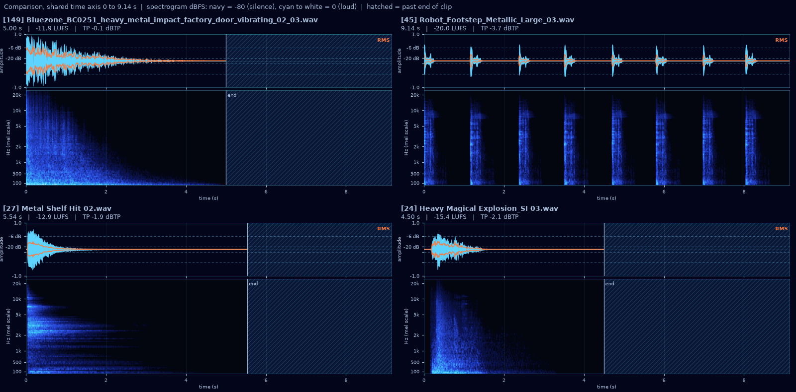

# MCP tools

Foley gives Claude Code (or any MCP client) seven [MCP](https://modelcontextprotocol.io/) tools over the catalog, served either by the shared endpoint of a running `foley browse` or by `foley-mcp` over stdio. Results are compact JSON: ids, library-relative paths, a one-line caption, the top tags and a few key numbers, never raw feature arrays, so a search costs few tokens.

**No tool modifies the audio library.** `import_to_project` writes only into the game project you name.

Units everywhere: durations in seconds, loudness in integrated LUFS, peaks in dBTP. `lufs` is `null` for clips shorter than 0.4 s, which are too short for an integrated measurement.

## Registering the server

There are two ways to connect. Both serve the same tools.

### The shared endpoint (recommended with an always-on `foley browse`)

A running `foley browse` serves the tools at `/mcp` when `foley.toml` has:

```toml
[mcp]
enabled = true
project_roots = ["C:/Projects"]   # where import_to_project may write
```

Every Claude Code session then connects to that one server and starts no process of its own. In the game repo's `.mcp.json`:

```json
{
  "mcpServers": {
    "foley": {
      "type": "http",
      "url": "http://foley.example.lan/mcp",
      "headers": { "Authorization": "Bearer ${FOLEY_MCP_TOKEN}" }
    }
  }
}
```

- **Token.** When the server listens on a network address, every request needs the token. Run `foley mcp token` on the server machine to print it (it is created on first use, in the data folder as `mcp_token`), and set it as the `FOLEY_MCP_TOKEN` environment variable for each person who uses Claude Code. Claude Code expands `${FOLEY_MCP_TOKEN}` when it reads `.mcp.json`, so the token never goes into the repo. A server bound to loopback only needs no token.
- **Imports.** Through the shared endpoint, the server writes the imported file on its own disk, so `import_to_project` accepts only a `project_root` inside one of `[mcp] project_roots`. Anything else is refused with a message naming that setting.
- **When the server is down**, Foley's tools are unavailable to every session until it is back. Reconnect from Claude Code's `/mcp` menu.

### `foley-mcp` over stdio

For a machine with a catalog but no running server. Claude Code starts one `foley-mcp` process per session:

```json
{
  "mcpServers": {
    "foley": {
      "command": "foley-mcp",
      "env": { "FOLEY_CONFIG": "C:/Users/me/AppData/Local/Foley/foley.toml" }
    }
  }
}
```

`env` is optional when `foley.toml` sits in the default data folder (see [configuration.md](configuration.md#where-foley-looks)). If `foley-mcp` is not on `PATH`, use the full path to the executable in the repo's `.venv\Scripts\` (or `.venv/bin/`). `import_to_project` may write into any project here, since the session's own user runs it on its own machine.

The server sends Claude a short instruction block describing the typical flow and how to read the images, so the tool descriptions below are mostly for you.

## Typical flow

1. `search_audio` with a short description of the sound and technical filters.
2. `find_similar` on a promising hit to see alternatives that sound alike.
3. `render_comparison` on the top 4 to 6 candidates; the comparison image comes back in the result, so Claude sees it directly.
4. `import_to_project` with the winner.

`get_shortlist` returns the sounds a person starred while listening in `foley browse`; Claude should check it before searching for something the user may already have picked.

---

## `search_audio`

Search the library by text.

| Input | Type | Notes |
| --- | --- | --- |
| `query` | string | A short description, e.g. `"heavy metal impact with a long ringing tail"`, `"short bright UI confirm beep"`. Include concrete words a file name might contain. Empty: list files matching the filters, by path. |
| `category` | string? | Folder or UCS category prefix. |
| `pack` | string? | Pack name (a folder under a `[library] pack_roots` folder). |
| `is_music` | bool? | `true` music only, `false` sound effects only. |
| `min_duration_s`, `max_duration_s` | number? | Duration range. |
| `min_lufs`, `max_lufs` | number? | Integrated loudness range. |
| `min_attack_s`, `max_attack_s` | number? | Attack time range (`max_attack_s = 0.01` for snappy hits). |
| `project` | string? | Hide files rejected for this project in the ledger. |
| `limit` | int | Default 20, at most 100. |

Returns:

```json
{
  "mode": "hybrid",            // "hybrid", "keyword", or "filter" for an empty query
  "model": "htsat-fused",      // CLAP checkpoint, hybrid mode only
  "note": null,                // why search is keyword-only, staleness, partial embeddings
  "results": [
    {
      "id": 149,
      "path": "packs/<pack>/<folder>/heavy_metal_impact_factory_door_02.wav",
      "score": 0.87,           // hybrid: blended 0..1; keyword: raw keyword score
      "similarity": 0.31,      // CLAP cosine of query text and audio; null if not embedded
      "caption": "5.00 s dark heavy metal impact, long tail, -12 LUFS",
      "tags": ["Explosion", "Music", "Artillery fire"],
      "duration_s": 5.0, "lufs": -11.9, "attack_s": 0.004,
      "license": null,
      "duplicates": 0          // other exact copies, already collapsed out of the list
    }
  ]
}
```

In **hybrid** mode, keyword matching (file names, folders, UCS categories, embedded metadata, AudioSet tags, captions) is blended with CLAP similarity between the query and the audio itself, so files are found by how they sound even when their names say nothing. In **keyword** mode (no embeddings yet, models not installed, or a blend weight of 0), words are OR-ed and files matching more of them rank higher: use words a file name might contain and try synonyms.

## `find_similar`

Sounds that sound like a given file: nearest neighbours by CLAP audio embedding, best first.

| Input | Type | Notes |
| --- | --- | --- |
| `asset_id` | int | The file to start from. |
| filters | | Same as `search_audio` (`category`, `pack`, `is_music`, duration, LUFS, attack ranges). |
| `project` | string? | Hide files rejected for this project. |
| `limit` | int | Default 20, at most 100. |

Returns the same shape as `search_audio` plus `source: {id, path}`. `score` equals `similarity`, the cosine: higher is closer, near 1 for variations of the same take. The file itself and its exact copies are left out. `note` explains an empty result (file not embedded yet, no CLAP model).

## `describe`

The full record for one file.

| Input | Type | Notes |
| --- | --- | --- |
| `asset` | int or string | Asset id or library-relative path. |

Returns asset fields, parsed embedded metadata (BWF, iXML, ID3), measured features (duration, sample rate, channels, integrated and short-term loudness, true peak, attack, decay, onsets, spectral centroid and rolloff, flatness, band energy, tempo, loop seam), tags with scores, the caption, the cached image path, exact duplicate copies, and past decisions and project usages from the ledger. It also returns `sidecar`: `{path, data, error}` for a file with a `.json` sidecar (a generation record with the prompt, model and licence), else `null`. It is larger than a search result; use it for a shortlisted candidate.

## `render_comparison`

Render 2 to 6 candidates into one grid PNG.

| Input | Type | Notes |
| --- | --- | --- |
| `asset_ids` | int[] | 2 to 6 ids. |

Returns two content blocks: the grid as a PNG image, then JSON `{"assets": [{id, path, duration_s, lufs}]}` in grid order. Over stdio the JSON also has `"image"`, the PNG's absolute path on disk, for people.



How to read it (the scales are fixed, so images compare across calls):

- **Waveform** (top of each cell): cyan, linear -1..1, with dashed lines at -6 and -20 dBFS. The orange line is the RMS envelope.
- **Spectrogram** (bottom): log-mel, 128 bands from 20 Hz to 24 kHz, fixed -80..0 dBFS. Near-black navy is silence, rising through blue and cyan to white at full scale.
- **Shared time axis:** every cell spans the longest clip. The hatched area after an `end` line is past the end of a shorter clip.

In the example, the second candidate is plainly a run of separate footsteps, not one impact, and the third has the long, tonal partials of a ringing metal shelf. That is the kind of judgement the grid lets Claude make without hearing anything.

## `import_to_project`

Copy a library file into a game project, loudness-normalized, and record the usage in the ledger.

| Input | Type | Notes |
| --- | --- | --- |
| `asset_id` | int | The file to import. |
| `project_root` | string | Absolute path of the game project. |
| `dest` | string | Destination as a `res://` path (`res://audio/sfx/laser.wav`) or a path relative to `project_root`. Must keep the source extension. |
| `usage_key` | string? | Slot name like `sfx.ui.click`; picks a target from the project's `foley.project.toml`. |
| `target_lufs` | number? | Explicit loudness target; overrides `usage_key`. |
| `overwrite` | bool | Default `false`: refuses to replace an existing file. |

Normalization:

- Clips of 0.4 s or longer are normalized to integrated LUFS; shorter ones on true peak (`[loudness] oneshot_peak_db`).
- The gain never pushes true peak above -1 dBTP (reported as `capped`).
- WAV, FLAC and AIFF are written normalized in their own format and bit depth (`gain_applied: true`).
- MP3 and OGG are copied unmodified, to avoid a second lossy encode: apply the returned `gain_db` in the engine (for Godot, `volume_db`).

Returns `{project_path, gain_db, gain_applied, normalized_to_lufs, capped, license, warnings}`, plus `no_redistribute: true` and a licence warning for a file under `[library] no_redistribute`. Without a target, the file is copied as is. See [configuration.md](configuration.md#per-project-settings-foleyprojecttoml) for `foley.project.toml`.

## `catalog_status`

No inputs. Returns catalog health: asset counts by status, the last scan and how stale it is, pending and settling files, archives that were never extracted, duplicate groups and reclaimable bytes, ledger usages whose source has gone missing, model coverage (`tags` and each CLAP checkpoint: done and pending) with checkpoint provenance and licences, and files that failed analysis. Claude should call it when results look stale or empty. `foley status` prints the same JSON.

## `get_shortlist`

No inputs. Returns `{"count": n, "items": [...]}`: the sounds a person starred in `foley browse`, newest first. Each item has `id` (null if the file is no longer in the catalog), `path`, `note` (often the intended use, such as "for the boss arena intro?"), `caption`, `duration_s`, `lufs`, `content_hash`, `added_at` and `status`. Stars are keyed by file content, so they survive moves and renames.

## Files that must not be passed on

Every result that names a library file (search and `find_similar` results, `describe`, shortlist items, `import_to_project`) carries `"no_redistribute": true` when the file lies under `[library] no_redistribute`. Such a file may be used inside the game, combined with other material, but never copied anywhere else on its own: not into a sound library, a shared folder, a release of raw assets or a public repository. The key is absent for other files.

## Errors

Expected failures (unknown id, bad id count, file missing from the library, destination exists) come back as MCP tool errors with a one-line message. If Foley is not configured, every tool says so and names the config locations it tried.
